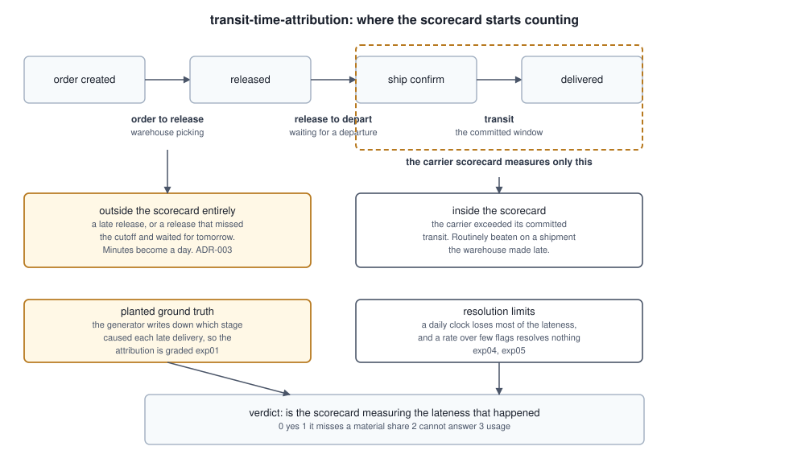
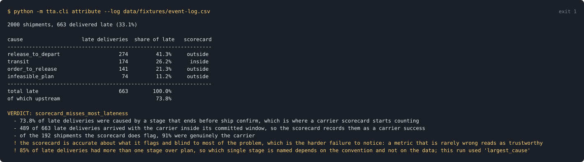

# transit-time-attribution

**A carrier scorecard starts its clock at ship confirm, so every delay that happened before that moment is outside the window it measures. On the event log here, 73.0% of late deliveries had a cause the scorecard cannot see, and it is right 92.6% of the time about the ones it does flag.**

[](https://github.com/GITHUB_USERNAME/transit-time-attribution/actions/workflows/ci.yml)


## The thing a carrier scorecard cannot tell you

On time in full is measured from ship confirm to delivery against a committed transit
window. A shipment the warehouse released after the day's last departure waits for
tomorrow, the carrier collects it the next morning, and delivers comfortably inside its
window from there. The scorecard records a carrier success. The customer records a late
delivery. **Both are correct, about different things.**

The delay is not measured imprecisely by the scorecard. It is not measured. There is no
term in it for anything before ship confirm, so a late release and a perfect release are
the same input.

Four questions this answers that a scorecard cannot:

1. Of the deliveries that arrived late, how many were caused by a stage that ends before
   the scorecard starts counting?
2. When the scorecard does flag a carrier, how often is it right, and what share of the
   problem is it seeing at all? Those are different questions and only one of them is
   usually asked.
3. What does a missed departure cutoff actually cost, and does that make two carriers on
   different lanes comparable?
4. How much of any of this survives the clock the transport system actually keeps?

## The uncomfortable numbers

Measured across twelve independent event logs of 4,000 shipments each:

> **Two bases appear in this repository and every figure states which it is on.** The
> headline figures and anything with a standard deviation are means over twelve logs of
> 4,000 shipments. The tables in Claims 1 and 2, the console output and the cause breakdown
> are the one committed fixture of 2000 shipments, so their denominators differ and their
> values differ in the first decimal. An audit found three ADRs calling a twelve log mean
> "on this repository's fixture", which is how a reader ends up comparing two numbers that
> were never the same measurement.

- **73.0% of late deliveries had a cause outside the scorecard's window**, with an sd of
  0.98 points. That splits into 64.2% caused by a stage that ends before ship confirm and
  8.8% whose plan never reached the promise, which is not a stage at all and is counted
  here because a scorecard cannot see a planning error either. Every one of them arrives
  with the carrier inside its committed window, so the scorecard records it as a carrier
  success. Its recall, 27.0%, is that share subtracted from one rather than a second
  measurement.
- **The scorecard is right 92.6% of the time about the shipments it flags**, with an sd of
  1.53 points across twelve logs. A metric that is nearly always right about what it flags
  and blind to most of the problem is the harder failure to notice, because being rarely
  wrong reads as being trustworthy.
- **61.8% of late deliveries have more than one stage over plan**, so which single stage
  gets named depends on a convention rather than on the data. Every convention names a cause
  that is true of the shipment on 100.0% of late deliveries; where they differ is which true
  cause they name, and the usual recovery figure for that, 88.4% at best and 69.7% at worst,
  measures agreement with an arbitrary label rather than correctness. ADR-008.
- **A daily clock loses 52% of the late deliveries outright**, and the rounding rule alone
  swings the count by 51%. Nothing errors. The operation simply looks better than it is.
- **In a 250 shipment sample the scorecard flags 21 shipments**, a granularity floor of
  5.09% and a sampling interval that cannot resolve anything below 12.50%. At that measured
  precision the claim needs 138 flagged shipments to separate, and on a single lane it takes
  8000 shipments before it holds across most months, because the precision varies between
  logs. The floor alone used to be the whole answer here and it is the narrower half of it:
  see ADR-005.

234 tests, 100.00% line coverage, and every figure above is re-measured by CI and checked
against this document in both directions on every push. The coverage figure is published to
two decimals because it used to be rounded to none, and a measurement a fifth of a point
short of a hundred formatted as a round hundred while the badge check compared the badge
against that same rounded value and agreed with itself. It happens to be a true hundred now;
the format is what makes it checkable.

## Quickstart

Requires Python 3.11 or newer. No API keys, no network, no cloud credentials.

```bash
git clone https://github.com/GITHUB_USERNAME/transit-time-attribution.git
cd transit-time-attribution
python -m pip install -e ".[dev]"

# the headline
python -m tta.cli attribute --log data/fixtures/event-log.csv

# what the sample and the clock can support
python -m tta.cli resolution --log data/fixtures/event-log.csv

# re-measure everything and check this README against it
make verify
```

## Claim 1: most of the lateness is outside the window

```
<!-- generated: cause-table.txt -->
cause                   late deliveries  share of late   scorecard
------------------------------------------------------------------
release_to_depart                   274         41.3%     outside
transit                             174         26.2%      inside
order_to_release                    141         21.3%     outside
infeasible_plan                      74         11.2%     outside
------------------------------------------------------------------
total late                          663        100.0%
of which upstream                               73.8%
<!-- end generated: cause-table.txt -->
```

The last column is the finding. One stage of three lies inside a carrier scorecard, and
it accounts for a quarter of the late deliveries on this log. This block is generated from
the committed fixture and the number checker asserts the README contains it verbatim, so
no cell here can drift.

`infeasible_plan` is its own cause rather than a stage failure: the delivery was late with
every stage inside its plan, because the plan never added up to the promise. Naming a
stage there would blame an operation for arithmetic done before it started.

## Claim 2: a missed cutoff is a step, which makes lanes incomparable

<!-- generated: lane-table.md -->
| Lane | Departures a day | A missed cutoff costs | Delivered late | Carrier caused | Carrier share of its lateness |
| --- | --- | --- | --- | --- | --- |
| GULF-THREE-DEPART | 3 | 6 hours | 26.6% | 9.1% | 34.3% |
| MIDWEST-ONE-DEPART | 1 | 24 hours | 36.4% | 9.0% | 24.6% |
| WEST-LONG-HAUL | 1 | 24 hours | 37.1% | 9.0% | 24.2% |
<!-- end generated: lane-table.md -->

Every lane is generated with the same mix of planted causes, so **the carriers are equally
good by construction**, and the measurement agrees in the only way it can: across twelve
logs the carrier caused rate varies by a spread of 0.2 points while the standard error of
any one lane's mean is 0.3 points. The spread is smaller than the error bar on the
quantities it separates, so **the ranking by carrier rate is not resolvable and must not be
read**. What differs is the timetable.

A shipment released one minute after the last departure on a single departure lane does
not leave one minute late. It leaves a day late. So the same upstream error rate produces
36.8% late on the single departure lanes against 26.6% on the lane with three, and the
carrier's share of its own lateness runs 24.4% on the single departure lanes against 34.3%
on the lane with three.

**One ranking here is resolvable and the other is not, and a scorecard reports both the
same way.** Delivered service varies by 10.5 points across the three lanes against a
standard error of 0.4, so that ordering is real and it is produced entirely by the
departure timetable. Carrier performance varies by less than its own error bar. A scorecard
comparing carriers across lanes of different departure frequency is therefore ranking them
on the one thing that differs between the lanes and is not the carrier.

## Claim 3: which upstream stage gets named is a convention

<!-- generated: convention-table.md -->
| Convention | Recovers the planted cause | Loses most on |
| --- | --- | --- |
| first_cause | 69.7% | missed_cutoff |
| largest_cause | 88.4% | warehouse |
| proportional | 88.4% | warehouse |
<!-- end generated: convention-table.md -->

**Read the second column before the first.** Every convention names a cause that is true
of the shipment on 100.0% of late deliveries. None of them ever names a stage that did not
run over its plan. The recovery column is a different measurement and a weaker one: it asks
whether the convention named the same true cause the generator happened to write down.

Those are not the same question because most of these shipments have more than one true
cause. A release that overran by six hours has also missed the day's last departure, so
`warehouse` and `missed_cutoff` are both true of it, and which was planted depends only on
which distribution the overrun was drawn from. Both labels are true of 96.2% of the
shipments carrying either one. So the recovery spread is the rate at which each convention's
tiebreak agrees with the generator's, and `first_cause` scores lower because it always names
the earlier stage while the generator names the larger overrun most of the time. ADR-008 is
the full account, including why the labels are not made disjoint.

`proportional` is not a third opinion either. It splits the lateness across every stage over
plan, and its reported cause is whichever stage holds the largest share, which is the
definition of `largest_cause`; the two agree on every shipment by construction and a test
says so. Reading its matching row as corroboration would be reading one rule printed twice.

This table has been wrong twice, in opposite directions, and both corrections are worth more
than the number. It first showed every convention below three quarters and called that a
ceiling on what attribution can do, which was the release overrun being charged twice and is
recorded in ADR-007. Then it showed 88.4% and called that recovery of the planted cause,
which treated an arbitrary label as ground truth. What is left is narrower than either: the
question "which upstream stage caused this" has more than one true answer on most late
deliveries, so a tool that returns one answer is returning a convention, and the convention
has to travel with the number.

**The headline does not depend on this choice.** Both upstream stages lie outside the
scorecard's window, so which one a convention names cannot change how much the scorecard
misses. Measured on each of twelve logs under each convention, the spread across
conventions measures 0.0 points, and a test fails if that ever stops being true. That
comparison used to run once on a single log outside the replication loop, which made a
robustness claim out of one draw. So this repository makes a strong claim about how much is
invisible and a scoped one about which team to talk to.

## Claim 4: the clock bounds everything above

<!-- generated: clock-table.md -->
| Clock | Rounding | Late deliveries | Upstream share |
| --- | --- | --- | --- |
| minute | floor | 1336 | 73.0% |
| minute | nearest | 1336 | 73.0% |
| quarter_hour | floor | 1333 | 73.0% |
| quarter_hour | nearest | 1333 | 73.0% |
| hour | floor | 1320 | 73.0% |
| hour | nearest | 1324 | 73.0% |
| day | floor | 642 | 90.1% |
| day | nearest | 970 | 75.5% |
<!-- end generated: clock-table.md -->

An hourly clock costs almost nothing, which was not the expected result and is reported as
measured: it shifts it by 0.03 points. A daily clock loses half the late deliveries, and
which half depends on the rounding rule, which no transport system records anywhere.

## What the measurement found

**A departure charge that blamed the warehouse for the timetable.** The first version
charged the whole release to departure wait. A shipment released at 06:00 on a lane whose
only departure is at 16:00 waits ten hours and did nothing wrong. The second version
charged the wait above a fixed handling floor, which is better and still wrong: an early
release can land in an unlucky part of the day just as easily as a late one. The confusion
matrix caught it, because shipments whose planted cause was an infeasible plan, with every
stage inside its plan, were being attributed to a departure wait they had not caused. The
charge is now a counterfactual: the departure the shipment caught, against the departure an
on plan release would have caught. ADR-003.

**Four planted labels that were not true, and one that is true twice.** Grading only works
if the ground truth is ground truth. Shipments labelled as on plan had drifted past a
cutoff, so the generator was producing a real missed cutoff and calling it nothing.
Shipments labelled infeasible plan had a departure wait that genuinely overran. Both showed
up in the confusion matrix as misattributions when the label was the thing that was wrong.
A third, found only when the generator was made to verify its own labels, had the bound for
a missed cutoff computed without the handling floor: on the lane whose departures are spaced
more closely than that floor the overrun was clamped to one minute, so about one in eight
shipments labelled `missed_cutoff` missed nothing, and the test that should have caught it
filters on lateness and those shipments were not late. A fourth was the verifier itself
demanding that an execution label also be late, which a lane with three departures a day
absorbs.

The fifth problem is not a false label. `warehouse` and `missed_cutoff` are both true of
almost every shipment carrying either, so the recovery rate measures which true label the
generator happened to record. That is ADR-008 and the reason this README reports
admissibility beside recovery.

**A ranking inversion I went looking for, and what I found instead.** I expected the
scorecard to name the wrong carrier outright, and the lane ordering does invert: the lane
with the best delivered service shows the highest carrier caused rate. I nearly published
that, and in one draft published both it and its opposite in two different documents, which
is what a claim looks like when nothing has measured whether it can be made. It cannot. The
carrier rates differ by 0.2 points and the standard error of each is 0.3, so the inversion
is an ordering of noise and so is its opposite. What the measurement supports is Claim 2:
one of these two rankings is resolvable, the other is not, and a scorecard prints them
identically.

## Architecture



## Evidence



Verbatim stdout, rendered by `tools/capture_evidence.py`, which runs the command and
writes what it printed. These SVGs are regenerated and checked for drift in CI, so they
cannot go stale while the numbers move.
[`docs/evidence-manifest.json`](docs/evidence-manifest.json) lists each captured command
with its exit code.

## What is in the fixture

2000 shipments across three lanes, generated with the cause of each late delivery written
down, because the quantity this tool produces is the one no transport system records.
There is no real log with a labelled answer, so grading the attribution at all requires
planting one.

Five planted causes, and two of them are deliberately kept apart:

- **warehouse** releases hours late. The overrun itself is the story.
- **missed_cutoff** releases minutes late, but late enough to miss the day's last
  departure. Both are upstream of ship confirm and they behave differently: one is
  proportional and one is a step. A tool that lumped them would report the right total and
  the wrong fix.
- **carrier** exceeds the committed transit window.
- **infeasible_plan** has every stage inside its plan and a promise the plan never reached.
- **none** releases on or before plan and arrives on time.

A control case runs the whole pipeline on a log containing only carrier caused lateness,
and the verdict comes back sound. A tool that found the same problem in every input would
be measuring its own assumptions.

## What this cannot measure

- **Whether a transport team acting on this would decide better.** The tool says the
  scorecard misses most of the lateness. It does not know what the warehouse could have
  done differently, what a later cutoff would cost to negotiate, or whether the carrier
  would accept a wider window. ADR-005.
- **Dirty timestamps, as opposed to coarse ones.** A scanner clock that drifts or a
  milestone backfilled by hand produces timestamps that are out of order, and those
  shipments are refused by name rather than repaired. That refusal is a selection effect
  nobody has measured: if chaotic shipments attract manual intervention, refusing them
  biases the attribution toward the shipments that went smoothly. The fixture produces
  none, so this repository cannot measure that bias and does not pretend to.
- **Ad hoc capacity.** The counterfactual assumes a fixed, known departure schedule. A
  lane where a shipment can be re-planned onto a different service has no single departure
  it "would have" caught.
- **Absolute levels that transfer.** The 73.0% upstream share follows from the planted
  cause mix. That it is not zero, and not visible from a scorecard, is general. Its size
  is not.

## Layout

```
src/tta/
  stages.py      the five timestamps, the three stages, and the one boundary a
                 scorecard starts at; refuses timestamps it cannot order
  attribute.py   per stage lateness, three conventions, and the counterfactual
                 departure charge that took two wrong answers to reach
  generator.py   a seeded event log with the cause of each late delivery planted
  resolution.py  clock coarsening, and the floor under every rate
  report.py      verdict policy, kept separate from the arithmetic
  cli.py         three subcommands, four exit codes
experiments/     six experiments writing JSON to docs/experiments/
tools/           collect_metrics.py, check_numbers.py, render_diagram.py,
                 capture_evidence.py
docs/adr/        eight decision records
data/fixtures/   the committed event log and its planted causes
```

## Exit codes

| Code | Meaning |
| --- | --- |
| 0 | the scorecard is measuring most of the lateness that happened |
| 1 | the analysis ran and the answer was no: it misses a material share |
| 2 | the analysis could not be run on this log |
| 3 | usage error |

1 and 2 are distinct on purpose. A transport team wiring this into a carrier review needs
to read the report on 1 and fix the data on 2. The distinction is declared where the
exception is raised rather than recovered from the message or the call site, so
`UnattributableShipment` subclasses both `AttributionError` and `ValueError`, and the
handler's `except` order resolves it to the exit code the author meant. An earlier version
of this paragraph said the distinction was carried by the type rather than inferred from
the class, which in Python is the same sentence twice.

## Make targets

| Target | What it does |
| --- | --- |
| `make lint` | ruff check and format check |
| `make test` | pytest with coverage and machine readable reports |
| `make experiments` | re-run every experiment |
| `make fixture` | regenerate the committed event log and its planted causes |
| `make receipts` | re-capture evidence, re-measure every figure, check this README |
| `make verify` | lint, test, receipts, then the suite again. ADR-006 says why twice |

`tools/check_numbers.py` works in both directions. Forward, every anchored figure must
appear inside its **anchor phrase** rather than as a bare digit. Reverse, any number in
this README, the defense guide, the ADRs or a source docstring that no anchor phrase
claims **fails the build**, which is what catches a figure corrupted into another measured
figure's value. The four tables above are generated and checked by block equality, since
their cells cannot be guarded by phrases.

Two limits are worth stating because the sentence above overstated them until an audit
measured it. Docstrings were being read and then discarded: the rule that drops any line
indented four spaces is right for a markdown code block and deletes the body of every
docstring inside a function, so four numbers were visible across fifteen source files and
two of them were wrong. Docstrings are dedented first now. The second limit stands: a figure
written in words is invisible to a digit scanner, and the worst inaccuracies this repository
has published were written in words. `#` comments and `tests/` are outside the checked set
too.

## Tech stack

| Technology | Role here | Why this one |
| --- | --- | --- |
| Python 3.11+ | everything | `itertools.pairwise` is how the timestamp ordering check reads as the invariant it is rather than as index arithmetic |
| numpy | the generator and the replication statistics | the cause mix is a weighted draw over thousands of shipments, which is one call and a loop otherwise |
| pandas | reading and writing event logs | a CSV with a header is what a transport team can actually export from a TMS |
| pytest | 234 tests | parametrising over three conventions and four clock granularities is how the convention findings are pinned without a copy of each test |
| ruff | lint and format | one tool, so a contributor cannot pass lint and fail format |
| GitHub Actions | re-measurement | the numbers in this README are only trustworthy if something recomputes them without being asked |

Deliberately absent: a date library. Every quantity here is a duration, and datetimes
would bring time zones and daylight saving into arithmetic that does not need them. A
lane's cutoff is a local hour, resolved once when the log is built. ADR-002 records what
that gives up.

## Decision records

- [ADR-001: Reconstruct the stages from the event log rather than reading the scorecard](docs/adr/ADR-001-reconstruct-stages-rather-than-read-the-scorecard.md)
- [ADR-002: Timestamps are seconds, and granularity bounds what can be attributed](docs/adr/ADR-002-timestamp-granularity-bounds-the-attribution.md)
- [ADR-003: Charge a missed departure by counterfactual, not by the wait](docs/adr/ADR-003-charge-a-missed-departure-by-counterfactual.md)
- [ADR-004: Report the convention beside every cause, because overlap is the norm](docs/adr/ADR-004-report-the-convention-beside-every-cause.md)
- [ADR-005: What a generated event log can and cannot establish](docs/adr/ADR-005-what-a-generated-event-log-cannot-establish.md)
- [ADR-006: The receipts suite is the one failure that cannot block collection](docs/adr/ADR-006-the-receipts-suite-is-the-one-failure-that-cannot-block-collection.md)
- [ADR-007: Charge the departure net of the overrun that forced it](docs/adr/ADR-007-charge-the-departure-net-of-the-overrun-that-forced-it.md)
- [ADR-008: Grade admissibility beside recovery, because the labels overlap](docs/adr/ADR-008-grade-admissibility-beside-recovery.md)

## The Pivot

**Out of scope: telling anyone what to fix.** Once the stages are attributed, the obvious
next step is to rank the interventions: move the cutoff an hour later, add a second
departure, tighten the pick line. That is deliberately not built, because ranking them
needs the cost of each, and this repository has no way to measure what a later cutoff
costs to negotiate or what a second departure costs to run.

The trigger for building it: a user who can supply a cost per intervention, or a carrier
contract with a schedule change clause that supplies one.

## Future work

- A block of lanes rather than three, so the comparability finding in Claim 2 can be
  stated as a correlation between departure frequency and apparent carrier quality rather
  than as three rows.
- Out of order timestamps in the generator, so the selection effect of refusing them
  becomes measurable rather than acknowledged.
- Partial attribution across stages carried through to the lane summary, since the
  proportional convention currently informs a shipment's shares and not the roll up.
- Promise setting as its own stage, because `infeasible_plan` is 11.2% of the late
  deliveries here and the tool currently says only that the plan was the problem.

First metric to watch on any of these: the share of late deliveries whose cause lies
outside the scorecard. If a new feature makes that share easier to ignore rather than
easier to see, it is the wrong feature.

## Licence

MIT. See [LICENSE](LICENSE).
